<p align="center">
  
</p>

# dotfiles

## Highlights

- **Agent-reproducible**: hand the repo URL to a coding agent and it follows [AGENTS.md](AGENTS.md) to rebuild the environment on a new Apple Silicon Mac.
- **Idempotent setup**: `setup.sh` can be re-run anytime; existing files are backed up before being replaced by links.
- **Secrets in the Keychain**: the `secret` command stores API keys in the macOS Keychain, never in files.
- **Tool stack**: Ghostty, zsh + starship, Neovim, yazi, lazygit, Hammerspoon, Karabiner (karabiner.ts) and Claude Code.

## Setup

Hand this repository's URL to a coding agent (Claude Code, etc.) on the new Mac and ask it to set things up. The agent follows [AGENTS.md](AGENTS.md), which covers prerequisites, verification, and the manual steps left for you.

Manually:

```zsh
xcode-select --install
git clone https://github.com/masaki39/dotfiles ~/ghq/github.com/masaki39/dotfiles
bash ~/ghq/github.com/masaki39/dotfiles/setup.sh
```

Then do the manual steps listed in [AGENTS.md](AGENTS.md#manual-steps-for-the-user).

## Secrets

API keys live in the macOS Keychain, not in files. Keys listed in `_SECRET_KEYS` (`zsh/secrets.zsh`) are exported on shell startup.

```zsh
secret set MY_API_KEY                 # add or update (prompts, or reads stdin)
secret get MY_API_KEY                 # print one value
secret rm MY_API_KEY                  # delete
secret ls                             # list key names
secret set projA/OPENAI_API_KEY       # project-scoped key (not auto-exported)
secret exec projA -- uv run main.py   # run with projA's keys
```
