<p align="center">
  
</p>

# dotfiles

## Highlights

- **Agent-reproducible**: hand the repo URL to a coding agent and it follows [AGENTS.md](AGENTS.md) to rebuild the environment on a new Apple Silicon Mac.
- **Idempotent setup**: `setup.sh` can be re-run anytime; existing files are backed up before being replaced by links.
- **Secrets in the Keychain**: [kenv](https://github.com/masaki39/kenv) stores API keys in a dedicated, auto-locking macOS keychain, never in files.
- **Tool stack**: Ghostty, zsh + starship, Neovim, yazi, lazygit, Hammerspoon, Karabiner (karabiner.ts) and Claude Code.

## Setup

Hand this repository's URL to a coding agent (Claude Code, etc.) on the new Mac and ask it to set things up. The agent follows [AGENTS.md](AGENTS.md), which covers prerequisites, verification, and the manual steps left for you.

Manually:

```zsh
xcode-select --install
git clone https://github.com/masaki39/dotfiles ~/ghq/github.com/masaki39/dotfiles
bash ~/ghq/github.com/masaki39/dotfiles/setup.sh
```

Then do the manual steps listed in [AGENTS.md](AGENTS.md#manual-steps-for-the-user).

## Secrets

API keys live in a dedicated macOS keychain managed by [kenv](https://github.com/masaki39/kenv), not in
files. Nothing is exported at shell startup: a key reaches only the command that needs it, and the keychain
locks after 5 minutes idle and on sleep. Wrapper functions in `zsh/functions.zsh` give commands their keys
automatically (e.g. `czg`).

```zsh
kenv init                             # once per machine: create the keychain
kenv set MY_API_KEY                   # add or update (prompts, or reads stdin)
kenv ls                               # list key names
kenv run MY_API_KEY -- some-cmd       # run with that key exported
kenv set projA/OPENAI_API_KEY         # project-scoped key
kenv run -p projA -- uv run main.py   # run with projA's keys
kenv lock                             # lock now
```

`claude/settings.json` denies Claude Code the common read paths (`kenv get/run` and `security`). These rules
are best-effort, not a guarantee: a nested shell, for example, can bypass them. The real protection is that
keys are never exported globally and the keychain locks after 5 minutes idle and on sleep.
