<p align="center">
  
</p>

# dotfiles

## Highlights

- **Agent-reproducible**: hand the repo URL to a coding agent and it follows [AGENTS.md](AGENTS.md) to rebuild the environment on a new Apple Silicon Mac.
- **Idempotent setup**: `setup.sh` can be re-run anytime; existing files are backed up before being replaced by links.
- **Secrets in the Keychain**: the `secret` command stores API keys in the macOS Keychain, never in files.
- **Tool stack**: Ghostty, zsh + starship, Neovim, yazi, lazygit, Hammerspoon, Karabiner (karabiner.ts) and Claude Code.

## Setup

Hand this repository's URL to a coding agent (Claude Code, etc.) on the new Mac and ask it to set things up. The agent follows [AGENTS.md](AGENTS.md), which covers prerequisites, verification, and the manual steps left for you.

Manually:

```zsh
xcode-select --install
git clone https://github.com/masaki39/dotfiles ~/ghq/github.com/masaki39/dotfiles
bash ~/ghq/github.com/masaki39/dotfiles/setup.sh
```

Then do the manual steps listed in [AGENTS.md](AGENTS.md#manual-steps-for-the-user).

## Secrets

API keys live in a dedicated macOS keychain, not in files. Nothing is exported at shell startup: a key
reaches only the command that needs it, and the keychain locks after 5 minutes idle and on sleep.
Commands listed in `_SECRET_WRAP` (`zsh/secrets.zsh`) get their keys automatically (e.g. `czg`).

```zsh
secret init                           # once per machine: create the keychain
secret set MY_API_KEY                 # add or update (prompts, or reads stdin)
secret get MY_API_KEY                 # print one value
secret rm MY_API_KEY                  # delete
secret ls                             # list key names
secret run MY_API_KEY -- some-cmd     # run with that key exported
secret set projA/OPENAI_API_KEY       # project-scoped key
secret exec projA -- uv run main.py   # run with projA's keys
secret lock                           # lock now
```

There is no `secret <KEY>` shorthand: an unknown subcommand prints usage and exits with status 2.
`claude/settings.json` denies Claude Code the common read paths (`secret get/run/exec/load`, the
`_secret_*` helpers and `security`). These rules are best-effort, not a guarantee: a nested shell, for
example, can bypass them. The real protection is that keys are never exported globally and the keychain
locks after 5 minutes idle and on sleep.
